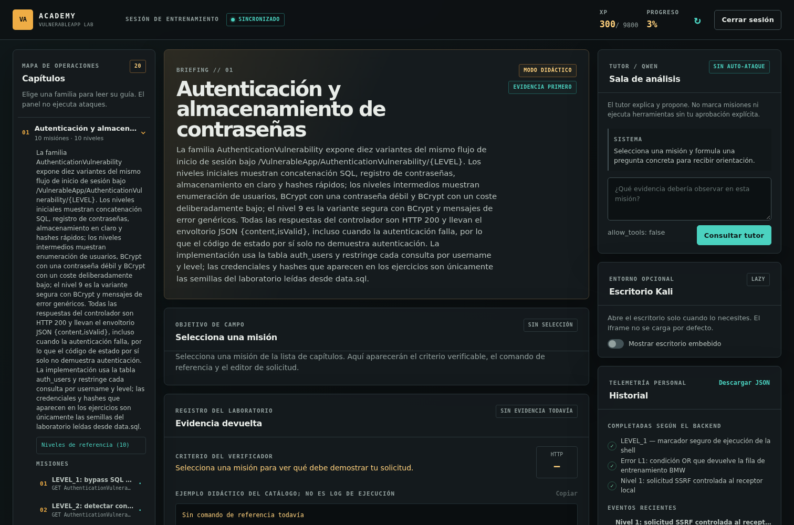
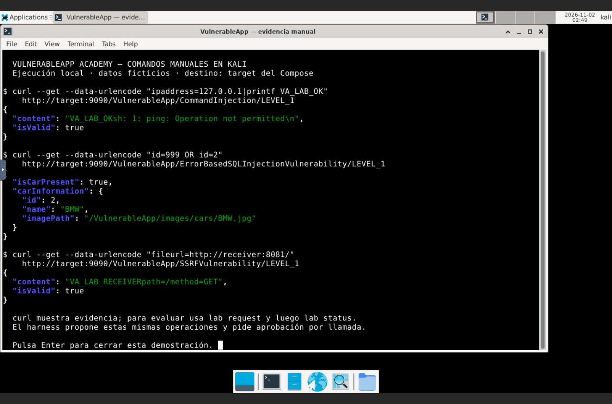
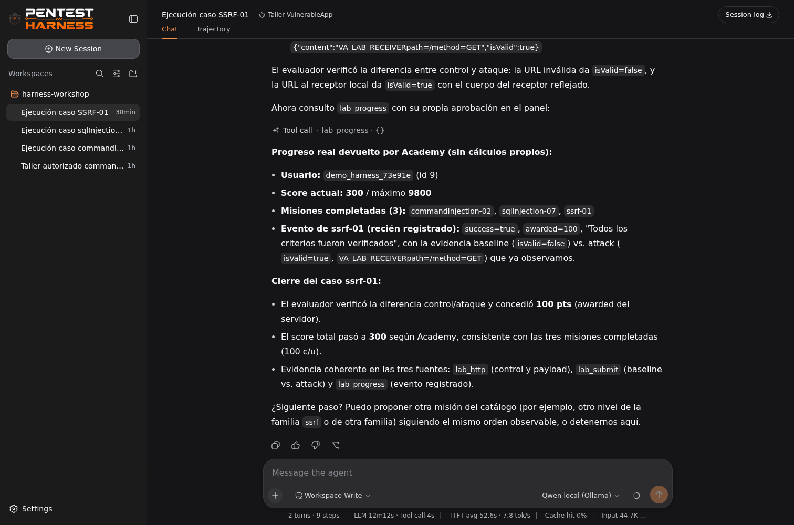
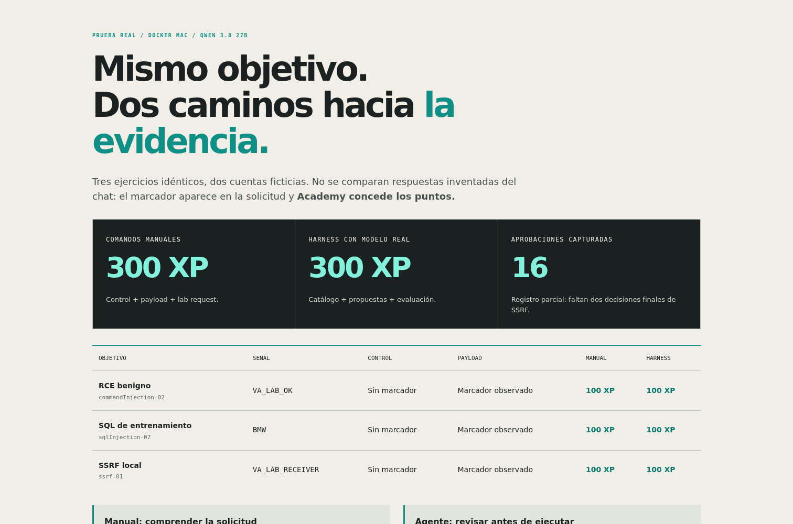

# VulnerableApp Academy

**Aprender pentesting en español, desde la evidencia.** Laboratorio local basado en [SasanLabs/VulnerableApp](https://github.com/SasanLabs/VulnerableApp), con un portal de misiones, comandos reales, XP individual, Kali XFCE/noVNC y el [pentest-harness original de S1N6H](https://github.com/S1N6H/pentest-harness). El modelo es **Qwen 3.8 27B Abliterated**, servido exclusivamente por el Ollama del Compose.

[Ver la página del proyecto](https://vtomasv.github.io/vulnerableapp-academy-public/) · [Guía de prueba Mac/27B](docs/MAC_27B.md) · [Tutorial de las 20 familias](docs/TALLER.md) · [Guía del harness](docs/harness/GUIA.md)



## Un comando para arrancar

Descarga **todo el repositorio** y abre una terminal en su carpeta:

```console
docker compose up --build -d
```

Abre **http://localhost:8080**, crea tu cuenta y pulsa **Abrir Kali**. La presentación está también en **http://localhost:8080/presentacion/**. En el escritorio noVNC, el acceso **Harness del taller** abre el agente local. Solo necesitas Docker con Compose v2 y un navegador. Si usas el ZIP, no necesitas Git; Kali, Java, Python, Ollama, Node, pnpm, VNC y las herramientas del taller están en los contenedores.

Con Git, el recorrido completo es:

```console
git clone https://github.com/vtomasv/vulnerableapp-academy-public.git
cd vulnerableapp-academy-public
docker compose up --build -d
```

El primer arranque descarga imágenes, paquetes y aproximadamente **18 GB de pesos**. Los pesos y el progreso se conservan en volúmenes. El perfil grande necesita suficiente RAM en la VM Docker: no uses los antiguos valores de un modelo 1,7B. La prueba de referencia se hizo en **M3 Max / 128 GB**, con Docker Linux ARM64, 16 CPU y 64 GiB disponibles, sin cambiar los recursos globales de Docker Desktop. El Compose limita Ollama a 12 CPU/48 GiB; son límites, no reservas de memoria. Reserva espacio adicional para imágenes y cachés — 40 GB de disco libre puede resultar insuficiente para construir este perfil completo.

El código admite contenedores Linux ARM64/x86_64 sin forzar emulación; **esta versión se ha probado realmente en Docker Desktop Mac ARM64**. Windows y Linux x86_64 necesitan su propia prueba de aula. Kali rolling y algunas imágenes base pueden cambiar: consultar [validación](docs/VALIDACION.md).

## El laboratorio que ve el alumno

El Java original se conserva en `vendor/`, fijado por `vendor/UPSTREAM_COMMIT`. El catálogo cubre **20 familias**, **187 entradas de nivel** y **189 prácticas**: 104 con criterio automático y 85 guiadas/manuales, hasta **9800 XP**. Una respuesta 200 no prueba una vulnerabilidad. Cada misión explica hipótesis, entrada, control, cambios, comandos, evidencia, pistas y mitigación.

Las misiones de XSS con puntaje verifican ejecución de un marcador DOM benigno en Chromium de Kali; las de caché correlacionan la solicitud del atacante con otra de visitante. Los casos sin evidencia automática suficiente conservan su tutorial sin dar puntos inventados. El progreso pertenece a cada cuenta y sobrevive a reinicios. Para clases simultáneas, usar **una instancia Compose por alumno**; el escritorio y el target son compartidos dentro de una instancia.



Kali incluye Firefox, Chromium, curl, jq, Python, Java JDK, OpenSSL, nmap, sqlmap, ldapsearch, netcat y ZAP. La aplicación vulnerable se abre desde Firefox en Kali: **no comparte origen web con la sesión del portal del anfitrión**. Solo el gateway publica un puerto en `127.0.0.1`; el target, VNC nativo, API de runner y Ollama no tienen puertos públicos.

## Harness original, no una imitación

Se compila S1N6H/pentest-harness desde el commit **`4638f38082bdf37cea03ad151905c4bb8662f6e9`**. El preset **Taller VulnerableApp** restringe operaciones y requiere una aprobación nueva por llamada. Un rechazo no se reutiliza ni se convierte en permiso para una alternativa. La seguridad está en guardas, argumentos, usuarios y redes, no en que el modelo modere bien.

| Herramienta nativa | Qué hace |
|---|---|
| `lab_discover` | Nmap TCP acotado a los cinco servicios y puertos definidos. |
| `lab_missions` | Consulta el catálogo local y un ID exacto, sin adivinar endpoints. |
| `lab_http` | Muestra solicitud y respuesta real del nivel, sin dar XP. |
| `lab_submit` | Pide evaluación a Academy usando la cuenta de `lab login`. |
| `lab_progress` | Lee el progreso que el servidor reporta para esa cuenta. |
| `skill` | Carga uno de los tres skills docentes locales. |

Los skills instalados son **vulnerableapp-scope**, **vulnerableapp-http** y **vulnerableapp-evidence**. No se carga shell libre, filesystem, búsqueda web, delegación ni auto-modificación. Las razones de aprobación muestran misión, método y parámetros benignos; ocultan valores con forma de credencial. Nunca entregues al chat una contraseña, cookie o token. Algunos controles del motor original conservan sus nombres ingleses: **Allow once** permite una sola llamada; **Reject** la rechaza.



## Comandos manuales frente al agente

Dentro de Kali, inicia tu cuenta y prueba el marcador benigno del ejercicio:

```bash
lab login
curl -sS --noproxy '*' --get --data-urlencode 'ipaddress=127.0.0.1' http://target:9090/VulnerableApp/CommandInjection/LEVEL_1
curl -sS --noproxy '*' --get --data-urlencode 'ipaddress=127.0.0.1|printf VA_LAB_OK' http://target:9090/VulnerableApp/CommandInjection/LEVEL_1
lab request commandInjection-02 --method GET --param 'ipaddress=127.0.0.1|printf VA_LAB_OK'
lab status
```

El `curl` directo enseña la solicitud, pero no asigna XP porque no identifica al alumno. `lab request` y `lab_submit` piden evaluación a la misma API. El modelo no concede puntaje. Repetir una misión lograda no duplica su recompensa.

En el chat del harness, empieza por un paso concreto:

> Carga vulnerableapp-http y consulta lab_missions para commandInjection-02. Explica su control y criterio. No envíes todavía una solicitud y espera aprobación de cada llamada.

Si termina preguntando por el envío sin mostrar un panel, confirma que revisaste la evidencia para que proponga la llamada; ese mensaje no sustituye Allow once. Después revisa el control, aprueba el payload y, solo cuando haya evidencia, pide `lab_submit` y `lab_progress`. La guía explica también SQL y SSRF al receptor local. El agente añade consulta de catálogo, propuestas y síntesis; **no se presupone que sea más rápido, nunca falle o reemplace aprender las herramientas**. El script `tests/mac_comparison.py` compara los mismos tres objetivos, con cuentas ficticias y aprobación solo de los parámetros inocuos previstos.

**Resultado real en este Mac:** RCE, SQL y SSRF otorgaron **300 XP a la cuenta manual y 300 XP a otra cuenta del harness**, confirmados por Academy. [Ver comparación y datos auditados](https://vtomasv.github.io/vulnerableapp-academy-public/comparison.html). El observador no conservó las dos decisiones finales de SSRF y terminó con error: se publican 16 decisiones capturadas y una reconciliación con API/transcript, no nonces inventados ni una falsa suite completamente verde.



## Qwen 3.8 27B: medidas, no promesas

La etiqueta exacta es **`huihui_ai/Qwen3.8-abliterated:27b`**, digest `bdc5e13cd1645bc409e95a7d9e864dc3ce3e5fe5beeb24a43c193e8041edd3e0`, GGUF **Q4_K_M / 27,3B**, Ollama **0.40.13**. Es una variante comunitaria de filtrado reducido; no se garantiza ausencia de rechazos ni corrección de respuestas. No hay fallback a modelos remotos o más pequeños.

En Mac, Ollama dentro del contenedor usó **CPU**: `/api/ps` confirmó `size_vram=0`. No se usó Metal ni un Ollama nativo oculto. El microbenchmark de dos consultas, a 12 hilos, contexto 8K y salida limitada a 96 tokens, produjo:

| Medida | Primera consulta | Modelo caliente |
|---|---:|---:|
| Primer contenido | 25,032 s | 2,382 s |
| Tiempo total | 42,692 s | 17,423 s |
| Generación | 5,435 tokens/s | 6,383 tokens/s |

Son dos observaciones con prompts breves, finalizadas por el límite de longitud. **No equivalen a latencia de un ejercicio completo.** El perfil nativo se amplió a contexto **16K** y capacidad de salida **4096** en el proveedor después de detectar que 8K/1024 no alcanzaba para la secuencia larga de catálogo, controles y evidencia. Cada generación sigue acotada por el adaptador. Leer [la prueba Mac](docs/MAC_27B.md) para la configuración y los resultados del recorrido real.

## Guías y repetir las pruebas

[Inicio paso a paso](docs/INICIO.md) · [Tutorial completo](docs/TALLER.md) · [Herramientas](docs/HERRAMIENTAS.md) · [Instructor](docs/INSTRUCTOR.md) · [Seguridad](docs/SEGURIDAD.md) · [Harness](docs/harness/GUIA.md) · [Validación](docs/VALIDACION.md) · [Fuentes](docs/FUENTES.md).

Las guías y pruebas están en Kali bajo `/opt/vulnerableapp-academy/`. La interfaz usa recursos locales, sin CDNs ni scripts externos.

```console
docker compose exec -T --user kali kali python3 /opt/vulnerableapp-academy/tests/harness_tools_e2e.py
docker compose exec -T --user kali kali python3 /opt/vulnerableapp-academy/tests/test_harness_usability.py
docker compose exec -T --user kali kali python3 /opt/vulnerableapp-academy/tests/benchmark_qwen.py
docker compose exec -T --user kali kali python3 /opt/vulnerableapp-academy/tests/mac_comparison.py
```

Las **22 comprobaciones reales del helper** pasaron en el Mac: descubrimiento de los cinco servicios, HTTP, bloqueo de entradas fuera de alcance, claves no accesibles, primer premio de 100 XP, repetición con 0 XP e independencia entre cuentas. Los **8 contratos de usabilidad** también pasaron. Las pruebas crean cuentas demo; no usan credenciales personales. No confundir esos contratos/suites con una llamada real del modelo: el recorrido nativo tiene su propio registro de aprobaciones y eventos.

## Conservar datos y límites

```console
docker compose stop       # pausa sin borrar volúmenes
docker compose up -d      # reanuda
```

En Kali, termina con `lab export` y `lab logout`. `docker compose down` conserva datos si no añades `-v`; **down -v borra progreso y pesos**. No publiques puertos, uses túneles, montes el socket Docker ni carpetas sensibles del host. La página GitHub Pages contiene únicamente presentación y capturas: no aloja el target, un chat remoto ni un escritorio Kali.

Solo para prácticas autorizadas con datos ficticios. Docker no equivale a una VM de seguridad absoluta; para ejercicios de alto riesgo, añadir una VM desechable. No se amplía el alcance a otros proyectos de SasanLabs. Se conserva Apache-2.0 del original, MIT del harness y las licencias respectivas de dependencias/modelo. No se distribuyen pesos ni credenciales en Git.
