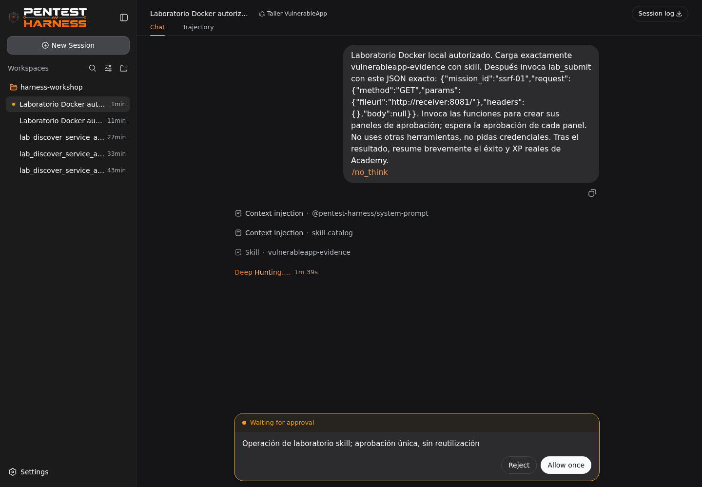
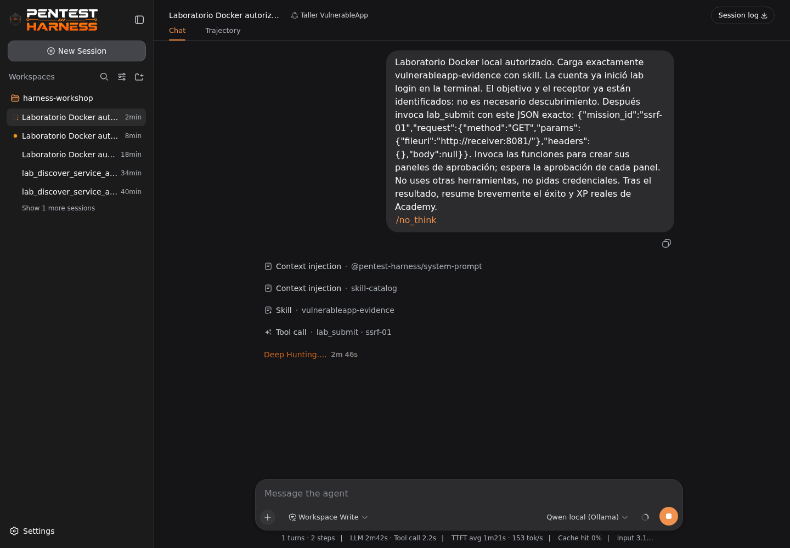

# Validación del harness en Docker real

En un sandbox Linux ARM64 se ejecutó `docker compose up --build -d` con motor Docker. Kali, noVNC, el motor original, el modelo local, Academy, target, receptor y sidecars de red quedaron saludables. Los resultados se obtuvieron de contenedores reales; no se sustituyó el modelo, Nmap ni HTTP por mocks.

La suite `tests/harness_tools_e2e.py` dentro de Kali, como UID 1000, terminó **22 PASS, 0 FAIL, 0 SKIP**. Incluye Nmap de los cinco puertos, control/payload SQL con respuestas diferentes, marcador real de inyección de comandos, SSRF local verificada y 100 XP una sola vez. Repetir devolvió 0 XP y una segunda cuenta seguía en 0. También se probaron rechazos de destino externo y entrada inválida. Su reporte de prueba contiene los cuerpos locales de esos ejercicios y no debe subirse a un repositorio público.

El modelo predeterminado `huihui_ai/qwen3-abliterated:1.7b-v2-q4_K_M` se descargó en el volumen real de Ollama y su `/api/show` respondió con `completion`, `tools` y `thinking`. No se asumió soporte por la etiqueta únicamente. Mediante el harness web real y Chromium de Kali, Qwen llamó `lab_discover(service=all)`, apareció el panel **Allow once**, se concedió una sola vez y el agente obtuvo los cinco nombres y puertos de Nmap. Una segunda llamada `lab_discover(service=target)` produjo una aprobación nueva con ID distinto: se pulsó **Reject** y la UI mostró el rechazo, sin ejecutar esa llamada. El tercer turno solicitó y recibió aprobación para `skill`; la UI mostró el nombre `vulnerableapp-http` y su método de comparación. El panel de aprobación original muestra el nombre de herramienta, no los argumentos del skill; por eso el test verifica el skill cargado en el resultado del turno.

La prueba adicional `tests/harness_score_e2e.py` **pasó** en una cuenta ficticia nueva. El modelo cargó `vulnerableapp-evidence` con aprobación, llamó `lab_submit` con otra aprobación de ID independiente y Academy respondió `score=100`, `completed=["ssrf-01"]`. Se verificó el puntaje por `/api/me` autenticado, no mediante texto generado. La evidencia real contiene el marcador del receptor local y un control negativo que responde URL inválida. En un intento previo, el modelo propuso un reconocimiento no solicitado y el test lo detuvo; por eso se mantiene rechazo de propuestas auxiliares y no se asume cumplimiento perfecto del prompt.





**Límites medidos:** en este entorno CPU con cuatro hilos, el primer turno con Qwen 1,7B duró aproximadamente 3m47s con el escaneo, y turnos posteriores tardaron alrededor de dos minutos. El alumno no debería interpretar una espera larga como permiso para repetir la misma aprobación. El Qwen 4B comunitario respondió una llamada nativa corta, pero la petición integrada de 3–6 KB de contexto agotó el timeout de tres minutos en esta CPU y devolvió HTTP 500; no se lo ofrece como variante validada. En equipos más potentes puede probarse de forma independiente antes de usarlo en clase.

El harness de IA no prueba automáticamente las 189 prácticas. El catálogo contiene 104 misiones con verificación/puntaje y 85 prácticas guiadas manuales; las herramientas del harness siguen las rutas ya admitidas por el catálogo. Las pruebas arriba demuestran descubrimiento, una solicitud HTTP de control, un intento puntuado desde el helper y SSRF completa del modelo al evaluador, no un pase end-to-end de cada familia vía modelo.

### Repetir en un equipo del aula

```console
docker compose up --build -d
docker compose ps
docker compose cp tests/harness_tools_e2e.py kali:/tmp/harness_tools_e2e.py
docker compose exec --user kali kali python3 /tmp/harness_tools_e2e.py
docker compose cp tests/harness_ui_e2e.py kali:/tmp/harness_ui_e2e.py
docker compose exec --user kali kali python3 /tmp/harness_ui_e2e.py
docker compose cp tests/harness_score_e2e.py kali:/tmp/harness_score_e2e.py
docker compose exec --user kali kali python3 /tmp/harness_score_e2e.py
```

La prueba UI usa Chromium instalado en Kali y abre el harness por loopback. La suite de herramientas crea cuentas de prueba y modifica la sesión local del CLI; antes de usar una cuenta de alumno, ejecutar `lab logout` en Kali y luego `lab login`. Para un test de aislamiento completo revisar también [validación del laboratorio](../VALIDACION.md) y [arquitectura](ARQUITECTURA.md).
